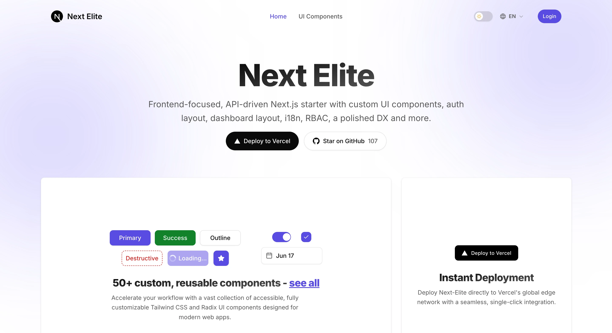
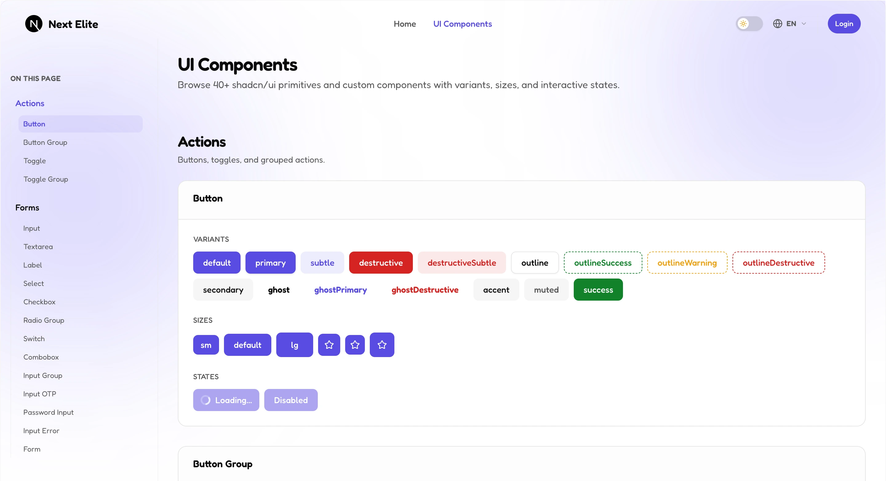
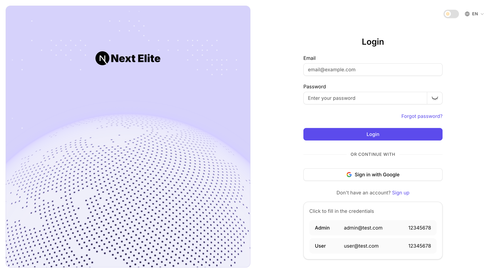
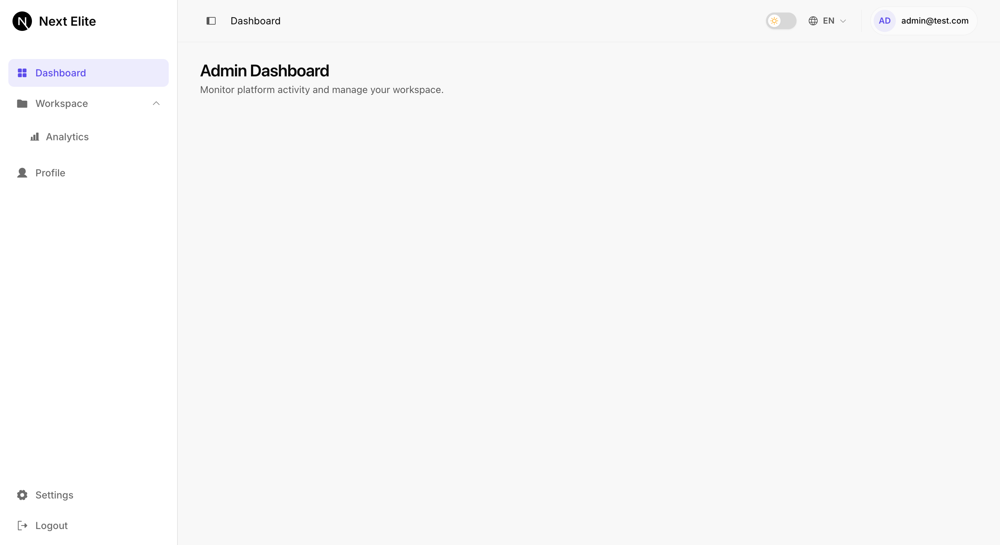
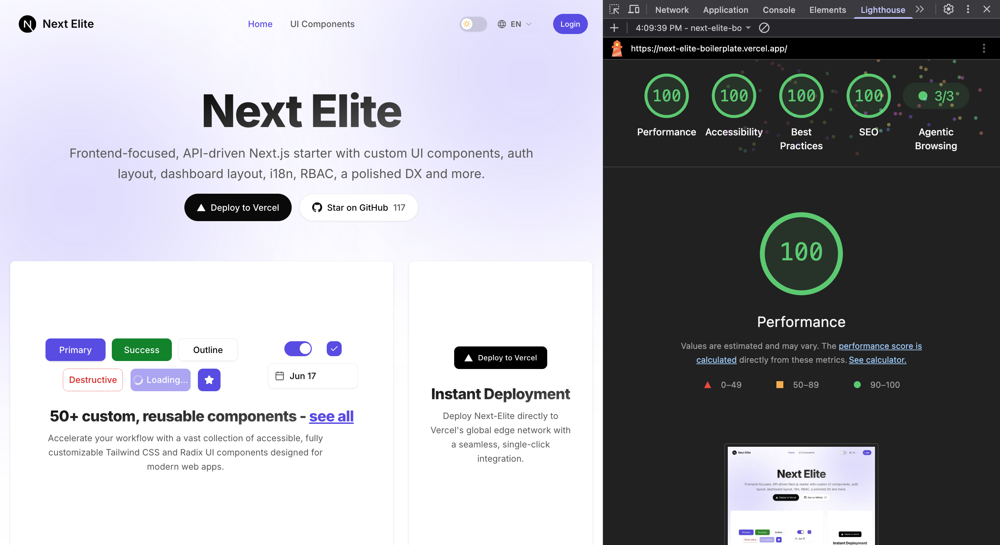
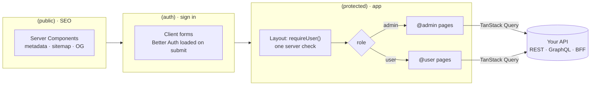

<h1 align="center">Next Elite</h1>

<p align="center">
  An open source, frontend-focused and API-driven Next.js boilerplate/starter kit built for developer experience. It's designed to consume external backends (REST, GraphQL, or BFF) and gives you a polished starting point with pre-built authentication layouts, dashboard layouts, and 50+ custom & reusable UI components.
</p>
<br/>
<p align="center">
  <a href="https://nextelite.salmanshahriar.com/"><strong>🚀 Live Demo</strong></a> ·
  <a href="https://github.com/salmanshahriar/Next-Elite/generate"><strong>📦 Use this Template</strong></a> ·
  <a href="https://github.com/salmanshahriar/Next-Elite/issues/new?labels=bug"><strong>🐛 Report Bug</strong></a> ·
  <a href="https://github.com/salmanshahriar/Next-Elite/issues/new?labels=enhancement"><strong>✨ Request Feature</strong></a>
</p>

<br/>

https://github.com/user-attachments/assets/519cc07b-7374-413f-b390-9a94f992b0f3

 <br/>

<div align="center">
  <table>
    <tr>
      <td width="50%" align="center">
        <h4>Next Elite</h4>
        
      </td>
      <td width="50%" align="center">
        <h4>50+ Custom Components</h4>
        
      </td>
    </tr>
    <tr>
      <td width="50%" align="center">
        <h4>Auth Layouts</h4>
        
      </td>
      <td width="50%" align="center">
        <h4>Dashboard Layouts</h4>
        
      </td>
    </tr>
  </table>
</div>

<br/>

**Highlights & Features:**

- **Next.js 16.4 + React 19.3** - Fast App Router, Turbopack, and Server Actions
- **TypeScript 7** - End-to-end type safety across components and routes
- **Oxlint + Oxfmt** - Blazing-fast linting & formatting with Lefthook pre-commit hooks
- **Next.js Best Practices** - Feature-based architecture and a standalone, multi-arch Docker build
- **Lean & Fast by Default** - ~184 KB Brotli first load, lazy-loaded auth, charts & menus, and per-page JS budgets enforced in CI
- **AI Agent Ready** - `AGENTS.md` and a `project-standards` skill in `.agents/skills/` keep AI coding agents on the project's conventions
- **Authentication & RBAC** - Email/Password & Google OAuth via BetterAuth with permission-based RBAC
- **Auth & Dashboard Layouts** - Split-pane auth layout & role-based dashboard layout with fixed sidebar navigation
- **50+ Custom & Reusable UI Components** - Accessible shadcn/ui primitives built with Tailwind CSS v4 & Radix UI
- **Type-Safe i18n** - Cookie-based multi-language support (6 locales, LTR + RTL) powered by next-intl
- **SEO & PWA Suite** - OpenGraph metadata, dynamic sitemap, robots.txt, web manifest, and llms.txt
- **Comprehensive Testing** - Unit/component testing with Vitest and E2E testing with Playwright
- **[Next Elite Server](https://github.com/salmanshahriar/Next-Elite-Server) (Coming Soon)** - Companion backend

<br/>

## 🚀 One-click Deploy to Vercel

[](https://vercel.com/new/clone?repository-url=https://github.com/salmanshahriar/Next-Elite)

Set environment variables from `.env.example` in Vercel project settings.

<br/>

## 💻 Tech Stack + Details

### Frameworks & Core

- **Next.js 16.4 (App Router)** - Fast, modern React framework with Turbopack.
- **TypeScript 7** - End-to-end type safety for rock-solid refactoring and developer experience.
- **Node.js 22.12+** - Built on the Node.js 22 LTS runtime.

### Authentication & Access Control

- **BetterAuth** - Out-of-the-box email/password and Google OAuth authentication using `/api/auth/*` route handlers.
- **Auth UI & Layout** - Split-pane authentication pages with an animated globe background (lazy-loaded, desktop only).
- **Role-Based Access Control (RBAC)** - `user` and `admin` roles. One `requireUser()` check in the protected layout picks the `@admin` or `@user` parallel route slot; `useAuth().hasPermission()` handles in-page checks.
- **Dashboard & Navigation** - Modern sidebar and Logout actions, mobile sheet, and topbar breadcrumbs.

### Internationalization (i18n)

- **next-intl** - Type-safe, cookie-based localizations (no URL prefix). Translation keys are type-checked (`t("key")` works; typos fail compile-time).

### UI & Styling

- **Tailwind CSS 4** - Utility-first styling with `@tailwindcss/postcss` and `tw-animate-css`.
- **Design Tokens** - Light and dark color, radius, and spacing tokens in `src/app/styles/tokens.css` (no hard-coded colors).
- **shadcn/ui** - Highly customizable UI components built with Tailwind CSS, Radix UI, and CVA.
- **Theme Support** - Easy light/dark mode transitions via theme toggle.

### API & Data Fetching

- **TanStack Query (React Query)** - Pre-configured `QueryProvider` in the protected layout (`src/components/shared/query-provider.tsx`) with sensible defaults (`staleTime`, `gcTime`, retry). Ready to wire `useQuery` / `useMutation` hooks to your REST, GraphQL, or BFF endpoints.

### Observability & Infrastructure

- **Sentry Integration** - Error tracking and performance instrumentation for client and server.
- **Vercel Analytics** - Page analytics via `@vercel/analytics`, rendered only when deployed on Vercel.
- **Health Probes** - Direct `GET /api/health` endpoint for load balancers.

### Quality Gates & Tooling

- **Validated Config** - Env vars are validated on the server with T3 Env.
- **Hygiene & Linting** - [Oxlint](https://oxc.rs/docs/guide/usage/linter) and [Oxfmt](https://oxc.rs/docs/guide/usage/formatter) for fast linting and formatting, plus Knip for dead code/dependency hygiene.
- **Testing Suite** - Unit/component testing with Vitest and React Testing Library, and E2E testing with Playwright.
- **Git Hook Automation** - Lefthook pre-commit hooks (oxlint + oxfmt), Commitlint for conventional commits, and a pre-push hook that runs `npm run check`.

<br/>

## 📈 Lighthouse Report

<div align="center">
  
</div>

<br/>

## 📦 Bundle Size

First-load JS with Brotli (gzip in brackets), including ~112 KB br of Next.js + React. Enforced by `npm run size`; inspect with `npm run analyze`.

| Page         | Size (after `npm run demo:remove`) |
| ------------ | ---------------------------------- |
| `/`          | 184 KB br (212 KB gz)              |
| `/login`     | 225 KB br (259 KB gz)              |
| `/dashboard` | 228 KB br (262 KB gz)              |

<br/>

## ⚡ Quick Start

### Prerequisites

- Node.js **22.12** or later
- **npm**

### Local Setup

1. Clone the repository and navigate into it:
   ```bash
   git clone https://github.com/salmanshahriar/Next-Elite.git
   cd Next-Elite
   ```
2. Install dependencies:
   ```bash
   npm install
   ```
3. Set up your environment variables:
   ```bash
   cp .env.example .env
   ```
4. Start the development server:
   ```bash
   npm run dev
   ```

Open [http://localhost:6767](http://localhost:6767) to view your local instance.

### Demo Credentials

When `NEXT_PUBLIC_DEMO_MODE=true` is enabled, the login screen includes a quick-fill panel with these seed credentials:

| Role  | Email            | Password   |
| ----- | ---------------- | ---------- |
| User  | `user@test.com`  | `12345678` |
| Admin | `admin@test.com` | `12345678` |

> [!NOTE]
> For production deployments, set `NEXT_PUBLIC_DEMO_MODE=false`.

### Removing the Demo Code

All demo code (landing page, `/ui-components` showcase, promo logos, demo accounts) lives in `src/_demo(DELETE)/`. When you're ready to build your own app, run:

```bash
npm run demo:remove
npm run check
```

### Docker & Production Containerization

The production setup uses a multi-stage **Google Distroless** base image (`gcr.io/distroless/nodejs22-debian12`) for maximum security, zero unnecessary OS packages, and minimal image size.

Run the application locally via Docker:

```bash
cp .env.example .env
docker build $(grep '^NEXT_PUBLIC_' .env | sed 's/^/--build-arg /') -t next-elite .
docker run --rm --env-file .env -p 6767:6767 next-elite
```

`NEXT_PUBLIC_*` values are baked in at build time, so they're passed as build args from `.env`.

Or using Docker Compose (reads the same build args from `.env`):

```bash
docker compose up --build
```

#### Multi-Arch Deploy (ARM64 + AMD64)

```bash
docker buildx create --name multiarch --use   # one-time setup
docker buildx build --platform linux/amd64,linux/arm64 -t next-elite .
```

#### Dokploy Deployment

This template is ready for [Dokploy](https://dokploy.com).

<br/>

## 🧩 Architecture Overview

Server-render what needs SEO, check the session once, render the app on the client, and fetch data from your API.



| Route group   | Renders                    | Auth                                    | Data                      |
| ------------- | -------------------------- | --------------------------------------- | ------------------------- |
| `(public)`    | Server (SEO)               | Reads the session for the header only   | Server                    |
| `(auth)`      | Server shell, client forms | Better Auth client loads on submit      | -                         |
| `(protected)` | Client                     | `requireUser()` once, role picks a slot | TanStack Query → your API |

No database in the frontend, no client session polling, and a per-page JS budget in CI.

<br/>

## ⚙️ Configuration

### Environment variables

Every variable is documented in [`.env.example`](.env.example) and validated by `src/libs/env.ts` (T3 Env).

### Site & SEO configuration

[`src/features/site/site.config.json`](src/features/site/site.config.json) is the central place for SEO metadata, dynamic sitemaps, localized routes, and PWA manifest:

```json
{
  "appName": "Next Elite",
  "domain": "https://yourdomain.com",
  "tagline": "Frontend-first, API-driven, batteries included.",
  "title": "Next Elite - Production-Ready SaaS Boilerplate",
  "description": "Frontend-first Next.js 16.4 + React 19 boilerplate with i18n, RBAC and BetterAuth."
}
```

<details>
<summary><b>Adding a Language</b></summary>

1. Add the locale code to `languages.supported` in `site.config.json` and add an entry under `languages.locales`.
2. Create `messages/<locale>.json` mirroring `messages/en.json`.
3. The `next-intl` runtime picks it up automatically; types update from `src/global.d.ts`.

</details>

<details>
<summary><b>Adding a Role</b></summary>

1. Append the role to the `UserRole` union in `src/features/auth/rbac/permissions.ts`.
2. Map permissions for the role in `ROLE_PERMISSIONS` in the same file.
3. Optional: add a parallel route slot - `src/app/(protected)/@<role>/...` - and update `(protected)/layout.tsx` to render it based on permissions.

</details>

<br/>

## 🧪 Development & Testing

<b>Scripts</b>

| Command                      | Description                              |
| ---------------------------- | ---------------------------------------- |
| `npm run dev`                | Start the dev server (port 6767)         |
| `npm run build`              | Production build                         |
| `npm run start`              | Start the production server (port 6767)  |
| `npm run start:standalone`   | Run standalone server (Playwright CI)    |
| `npm run analyze`            | Inspect what's in each page's bundle     |
| `npm run typecheck`          | `tsc --noEmit`                           |
| `npm run lint`               | Oxlint + Oxfmt check                     |
| `npm run lint:fix`           | Auto-fix with Oxlint + Oxfmt             |
| `npm run knip`               | Detect unused files / exports / deps     |
| `npm run check`              | CI gate: typecheck + lint + knip + tests |
| `npm run size`               | Check per-page JS budget (after build)   |
| `npm run test`               | Vitest run                               |
| `npm run test:watch`         | Vitest watch mode                        |
| `npm run playwright:install` | Download Playwright browsers             |
| `npm run e2e`                | Playwright E2E                           |

<details>
<summary><b>Testing Details</b></summary>

- **Unit / component:** Vitest + React Testing Library (`config/vitest.config.ts`). Tests live in `src/tests/`, mirroring the `src/` folder structure (`*.test.ts` / `*.test.tsx`). Use `renderWithProviders` from `@/tests/render` for components that need app context (i18n, theme, auth, React Query). Plain `render` is fine for isolated UI primitives.
- **End-to-end:** Playwright in `e2e/` on port **6767** (`127.0.0.1`). Local runs use `next dev` (all browsers); CI uses production `next start` (Chromium only). Run `playwright:install` before the first E2E run; on Linux, also run `npx playwright install-deps` (sudo). Use `npm run e2e -- --ui` for UI mode or `--project=webkit` for one browser. Stop `npm run dev` before `npm run e2e` - E2E starts its own server.

</details>

<details>
<summary><b>CI/CD Pipeline</b></summary>

- `.github/workflows/check.yml` - typecheck → lint → knip → unit tests → build → bundle size budget, on every push and PR. A second job runs `demo:remove` and the same checks.
- `.github/workflows/playwright.yml` - build → Playwright E2E (Chromium, production server).
- `.github/dependabot.yml` - weekly npm and GitHub Actions update PRs.

</details>

<br/>

## 🎯 When to Use

Next Elite is best for:

- SaaS apps with multiple user roles.
- Multi-lingual/Internationalized products (LTR + RTL).
- Frontends consuming an existing backend or BFF.
- Projects requiring a clean, feature-based modular structure.

It is probably overkill for:

- Single-page landing sites.
- Apps that need a tightly-coupled DB layer (API-only design).

<br/>

## 🤝 Contributing

Contributions to **Next-Elite** are welcome.

1. Fork the repository and create a branch from `main`.
2. Use clear branch names such as `feat/...`, `fix/...`, or `docs/...`.
3. Run `npm run check` before submitting your changes.
4. Follow **Conventional Commits**.
5. Open a Pull Request with a clear description of your changes.

<br/>

## 📜 License

MIT [LICENSE](LICENSE)

<br/>

## ⭐ Support Next-Elite

If you find **Next-Elite** useful, consider giving it a ⭐ **[Star on GitHub](https://github.com/salmanshahriar/Next-Elite)**.

Thanks for reading!
